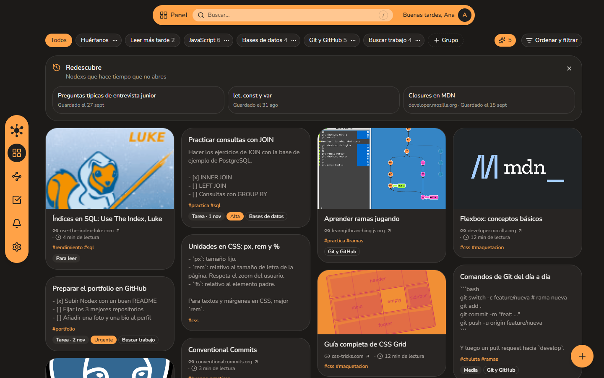
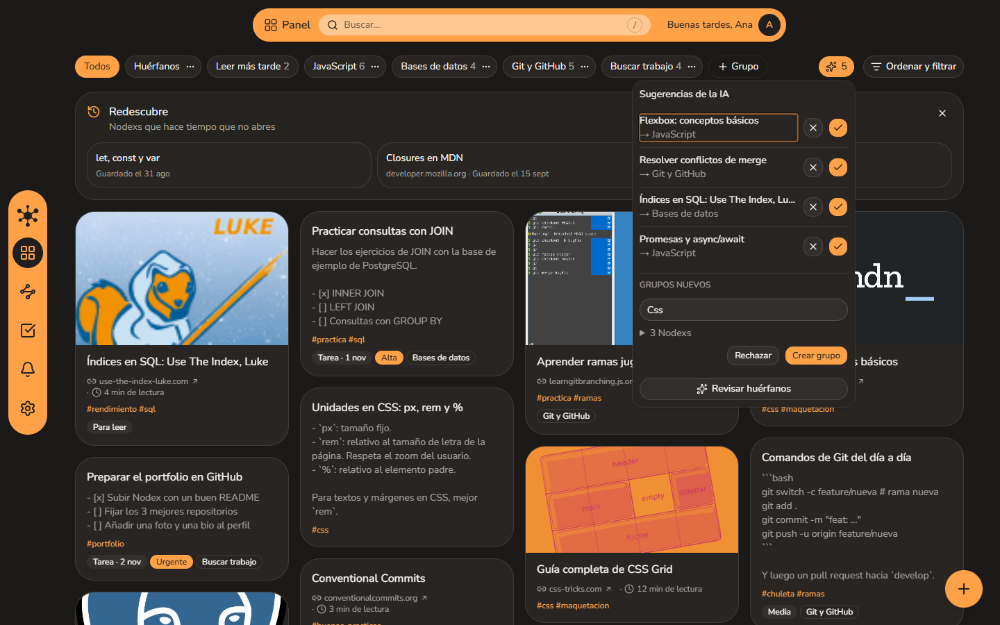
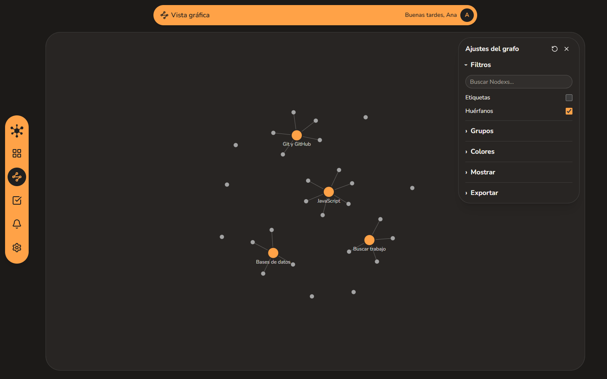
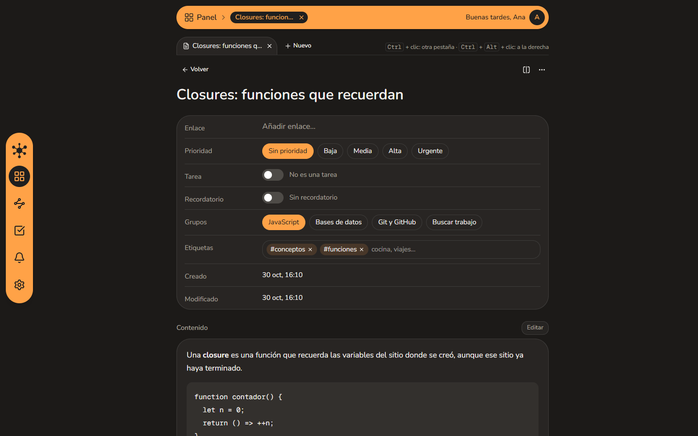
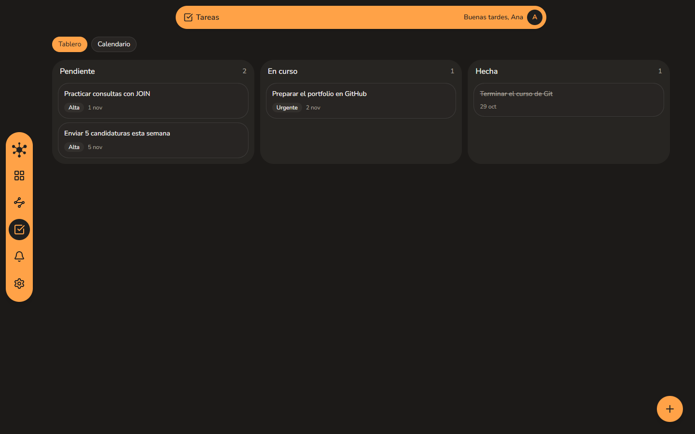
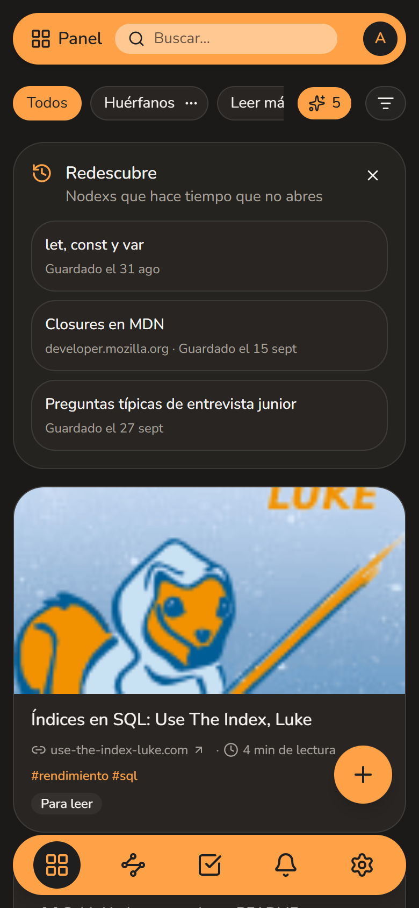
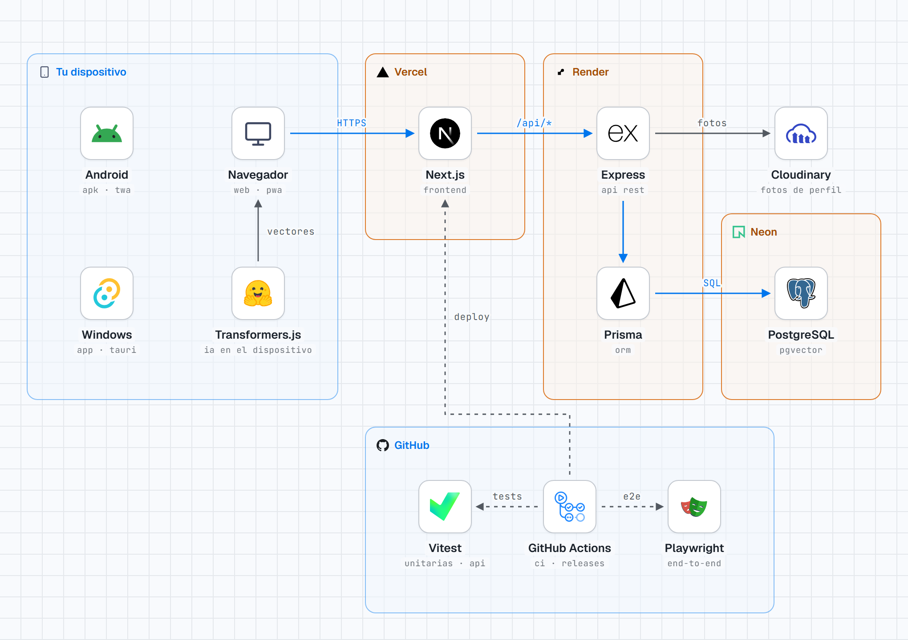

<!-- prettier-ignore -->
<div align="center">


# Nodex

**Tus notas y enlaces, conectados.**

[](https://nodex-three.vercel.app)
[](#descargar)
[](https://github.com/jcasadomolina/Nodex/actions/workflows/tests.yml)
<br>
[](https://www.typescriptlang.org)
[](https://nextjs.org)
[](https://expressjs.com)
[](https://github.com/pgvector/pgvector)
[](LICENSE)

[Qué es](#qué-es) • [Funcionalidades](#funcionalidades) • [Descargar](#descargar) • [Arquitectura](#arquitectura) • [Puesta en marcha](#puesta-en-marcha) • [Documentación](#documentación)


</div>

Nodex es una aplicación para guardar notas y enlaces en un solo sitio y dejar que una IA los ordene. Cada nota o enlace es un **Nodex**: se agrupa, se relaciona con los demás por su significado y se puede ver como un grafo. Funciona en el navegador, se instala como PWA y tiene apps para Android y Windows.

> [!TIP]
> Puedes probarla sin registrarte: entra en [nodex-three.vercel.app](https://nodex-three.vercel.app) y pulsa **Probar sin registrarse**. Se crea una cuenta con datos de ejemplo que se borra a las 24 horas, o que puedes convertir en tu cuenta sin perder nada.

## Qué es

Guardar cosas es fácil; volver a encontrarlas, no. Nodex intenta que lo que guardas se ordene casi solo:

- La IA propone a qué **grupo** va cada Nodex suelto, y sugiere grupos nuevos cuando varios hablan de lo mismo.
- La **búsqueda** entiende el significado: "historial de cambios del código" encuentra tus apuntes de Git aunque no compartan ninguna palabra.
- El **grafo** muestra de un vistazo cómo se conecta todo, al estilo de Obsidian.

La IA funciona **en tu dispositivo**: el modelo de *embeddings* se descarga una vez (unos 120 MB, solo si lo aceptas) y tus notas no salen de tu navegador para calcularla. No usa APIs de pago.

## Funcionalidades

- **Notas y enlaces**: notas en Markdown; enlaces con vista previa, tiempo de lectura y aviso si la página deja de existir.
- **Grupos con IA**: sugerencias de grupo para los Nodexs sin grupo y propuestas de grupos nuevos. La IA nunca mueve nada sin que aceptes.
- **Búsqueda por significado**: búsqueda híbrida (significado + texto), Nodexs relacionados y aviso de duplicados.
- **Grafo interactivo** de grupos y Nodexs.
- **Tareas y recordatorios**: cualquier Nodex puede ser una tarea, con tablero y calendario, o tener un recordatorio con notificación push.
- **Organización**: prioridades, etiquetas, *Leer más tarde*, *Redescubre* (Nodexs olvidados) y papelera con 30 días para restaurar.
- **Vista de trabajo**: pestañas y dos paneles, como en un editor de código.
- **Cuentas**: registro con email, Google o GitHub, perfil con foto y tutorial de bienvenida.
- **En todas partes**: PWA instalable con página sin conexión y menú Compartir en Android, más apps para Android y Windows.

<table>
  <tr>
    <td width="50%" align="center">
      
      <br><b>Panel</b>: grupos, filtros y <i>Redescubre</i>
    </td>
    <td width="50%" align="center">
      
      <br><b>Sugerencias de la IA</b>: grupo para cada huérfano y grupos nuevos
    </td>
  </tr>
  <tr>
    <td width="50%" align="center">
      
      <br><b>Vista gráfica</b>: grupos y Nodexs como una red
    </td>
    <td width="50%" align="center">
      
      <br><b>Nodex</b>: propiedades, pestañas y contenido en Markdown
    </td>
  </tr>
  <tr>
    <td width="50%" align="center">
      
      <br><b>Tareas</b>: tablero y calendario
    </td>
    <td width="50%" align="center">
      
      <br><b>Móvil</b>: interfaz adaptada e instalable como app
    </td>
  </tr>
</table>

## Descargar

Las apps cargan la misma web, así que siempre tienen la última versión sin actualizar nada.

| Plataforma | Descarga | Requisitos |
|------------|----------|------------|
| Android | [**Nodex.apk**](https://github.com/jcasadomolina/Nodex/releases/latest/download/Nodex.apk) | Android 7.0 o superior |
| Windows | [**Nodex-setup.exe**](https://github.com/jcasadomolina/Nodex/releases/latest/download/Nodex-setup.exe) | Windows 10 u 11 |
| Navegador | [nodex-three.vercel.app](https://nodex-three.vercel.app) | Cualquier navegador moderno; desde el menú se instala como PWA |

> [!NOTE]
> Las apps no vienen de ninguna tienda. En Android, permite "instalar apps de origen desconocido" al abrir el APK. En Windows, el instalador no está firmado: si aparece "Windows protegió tu PC", pulsa **Más información → Ejecutar de todas formas**. En la app de Windows no hay notificaciones push; el resto funciona igual que en la web.

## Arquitectura

<picture>
  <source media="(prefers-color-scheme: dark)" srcset="docs/readme/stack-dark.png">
  
</picture>

| Parte | Tecnologías |
|-------|-------------|
| Frontend | Next.js 16, React 19, Tailwind CSS 4, shadcn/ui, TanStack Query, D3 |
| Backend | Express 5, Prisma 7, Zod, Passport (Google y GitHub), argon2, Web Push |
| Datos | PostgreSQL con pgvector en Neon; fotos en Cloudinary |
| IA | Transformers.js con `paraphrase-multilingual-MiniLM-L12-v2` (384 dimensiones), en el dispositivo |
| Apps | TWA (Bubblewrap) para Android y Tauri v2 para Windows |
| Calidad | Vitest, Supertest y Playwright, con GitHub Actions en cada pull request |

El navegador solo habla con un dominio: Next.js reenvía `/api/*` al backend, así que la cookie de sesión viaja sola y no hace falta CORS. Cada consulta filtra por el usuario de la sesión, de modo que los datos de cada usuario quedan aislados. El backend nunca carga el modelo de IA: solo guarda y compara vectores, y así cabe en los 512 MB del plan gratuito de Render. Además ejecuta tareas de fondo: recordatorios, comprobación de enlaces rotos y limpieza de la papelera y de las demos caducadas.

## Puesta en marcha

Necesitas **Node.js 22.9 o superior** y una base de datos **PostgreSQL con pgvector** (el plan gratuito de [Neon](https://neon.tech) sirve).

1. Clona el repositorio y copia `.env.example` a `.env` en la raíz. Rellena al menos `DATABASE_URL`, `DIRECT_URL` y `SESSION_SECRET`.

2. Arranca el backend:

   ```bash
   cd backend
   npm install
   npm run db:deploy
   npm run dev
   ```

3. En otra terminal, arranca el frontend:

   ```bash
   cd frontend
   npm install
   npm run dev
   ```

4. Abre `http://localhost:3000`.

> [!TIP]
> El resto de variables (Google, GitHub, Cloudinary y las claves VAPID de las notificaciones) son opcionales. Sin ellas, esa función se desactiva y la aplicación sigue funcionando.

Las pruebas se ejecutan con `npm test` en `backend/` y en `frontend/`. Las del backend necesitan Docker, que levanta una base de datos de prueba: `docker compose up -d db-test`. Los detalles de cada parte están en [backend/README.md](backend/README.md) y [frontend/README.md](frontend/README.md).

## Documentación

La carpeta [`docs/`](docs/README.md) explica qué se construye y por qué, escrita para que se entienda sin experiencia previa en estas tecnologías:

- [Requisitos de producto](docs/03-requisitos-producto.md): historias de usuario con sus requisitos.
- [Backend](docs/06-sistema-backend.md), [Base de datos](docs/08-base-de-datos.md) y [Frontend](docs/09-frontend.md): cómo funciona cada parte.
- [Pruebas](docs/10-pruebas.md), [Despliegue](docs/11-despliegue.md) y [Apps](docs/12-apps.md): cómo se prueba, se publica y se empaqueta.

## Cómo se ha hecho

Nodex es el primer proyecto de [José Antonio Casado Molina](https://github.com/jcasadomolina) como desarrollador junior, hecho con ayuda de IA (Claude Code). Cada funcionalidad se diseña, se aprueba y se documenta antes de programarla, y llega a `develop` por pull request desde su propia rama, siguiendo GitFlow.
