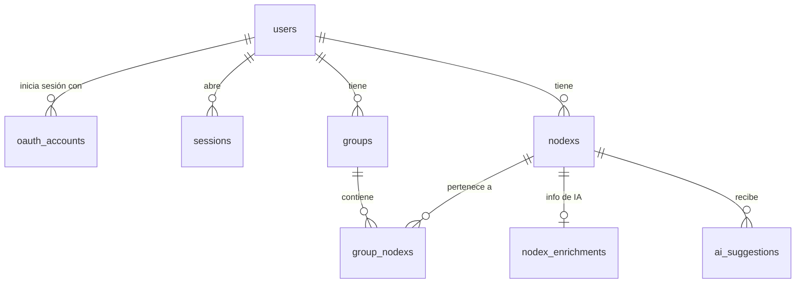

# Base de datos

Diseño aprobado de la base de datos de Nodex: qué se usa, cómo se organizan las tablas y por qué.

## Decisiones

| Decisión | Elección | Motivo |
|----------|----------|--------|
| Tipo | Relacional: **PostgreSQL** | Los datos están muy relacionados (usuario → grupos → Nodexs) y las claves foráneas garantizan que esas relaciones sean siempre válidas. Además, la extensión **pgvector** permitirá a la IA buscar grupos parecidos a un Nodex. |
| Alojamiento | **Neon**, plan gratuito | Base en la nube con panel de administrador. Cuando está inactiva se duerme, pero se despierta sola con la siguiente consulta: no hay que reactivarla a mano. |
| Acceso desde el código | **Prisma** (ORM) | Define el esquema en un solo archivo legible y genera las migraciones. |
| Identificadores | **UUID** | Las URLs no revelan cuántos registros hay ni permiten adivinar IDs consecutivos. |

> Los límites del plan gratuito de Neon (unos 0,5 GB por proyecto) se comprobarán al crear la cuenta. Las imágenes, como la foto de perfil, no se guardan en la base: irán a un servicio de archivos que se decidirá en el bloque de backend.

## Conceptos

- **Clave primaria (PK):** columna que identifica cada fila de forma única, como el `id`.
- **Clave foránea (FK):** columna que apunta a la clave primaria de otra tabla. La base de datos no deja guardar un `user_id` que no exista en `users`.
- **`ON DELETE CASCADE`:** al borrar la fila "padre", se borran también sus "hijas". Si se elimina un usuario, desaparecen sus grupos y Nodexs.
- **Relación muchos a muchos:** un Nodex puede estar en varios grupos, y un grupo tiene varios Nodexs. Se resuelve con una tabla intermedia (`group_nodexs`) que guarda las parejas.
- **Índice:** estructura que acelera las búsquedas por ciertas columnas, como el índice de un libro.
- **Migración:** archivo SQL versionado que describe un cambio en la estructura de la base. Es el equivalente a un commit, pero de la base de datos.
- **JSONB:** columna que guarda un objeto JSON flexible dentro de una fila.

## Diagrama

## Tablas

Todas las fechas son `timestamptz` (fecha y hora con zona horaria). `created_at` toma por defecto la fecha actual.

### `users` (HU-01, HU-02)

| Columna | Tipo | Notas |
|---------|------|-------|
| `id` | uuid | PK |
| `name` | text | Obligatorio |
| `email` | text | Obligatorio, único, guardado en minúsculas (`RF-01.3`) |
| `password_hash` | text | Contraseña cifrada (`RF-01.4`). Vacío si el usuario entra solo con Google o GitHub |
| `avatar_url` | text | Opcional (`RF-02.3`) |
| `tutorial_completed_version` | integer | Última versión del tutorial que ha visto (`RF-10.4`). `null` si nunca lo ha visto |
| `created_at`, `updated_at` | timestamptz | |

### `oauth_accounts` (`RF-01.2`)

Cuentas de Google o GitHub vinculadas a un usuario. Un mismo usuario puede tener contraseña y además una o varias cuentas externas.

| Columna | Tipo | Notas |
|---------|------|-------|
| `id` | uuid | PK |
| `user_id` | uuid | FK → `users`, cascade |
| `provider` | text | `google` o `github` |
| `provider_account_id` | text | ID del usuario en ese proveedor |
| `created_at` | timestamptz | |

Único por (`provider`, `provider_account_id`).

### `sessions` (`RNF-9.2`, `RF-01.7`)

Sesiones de inicio de sesión guardadas en la propia base, para que sobrevivan a un reinicio del servidor. El formato exacto se ajustará a la librería de sesiones que se elija en el bloque de backend.

| Columna | Tipo | Notas |
|---------|------|-------|
| `sid` | text | PK, identificador de la sesión |
| `sess` | jsonb | Datos de la sesión |
| `expire` | timestamptz | Caducidad; con índice para limpiar las caducadas |

### `groups` (HU-04)

| Columna | Tipo | Notas |
|---------|------|-------|
| `id` | uuid | PK |
| `user_id` | uuid | FK → `users`, cascade |
| `name` | text | Obligatorio |
| `description` | text | Opcional |
| `created_at`, `updated_at` | timestamptz | |
| `deleted_at` | timestamptz | Borrado lógico (ver reglas) |

El nombre es único por usuario entre los grupos no borrados.

### `nodexs` (HU-05)

| Columna | Tipo | Notas |
|---------|------|-------|
| `id` | uuid | PK |
| `user_id` | uuid | FK → `users`, cascade |
| `type` | text | `note` o `link` |
| `title` | text | Obligatorio |
| `content` | text | Texto de la nota, opcional |
| `url` | text | Solo en enlaces |
| `source` | text | Origen: `manual` o `share` (menú Compartir de la PWA). Por defecto `manual` |
| `priority` | smallint | Prioridad subjetiva (HU-11): 1 baja, 2 media, 3 alta, 4 urgente; `null` sin prioridad. En la API se usan los nombres (`low`…`urgent`) |
| `metadata` | jsonb | Datos extra flexibles (miniatura, autor…). Por defecto `{}` |
| `embedding` | vector(384) | Vector que representa el significado del Nodex, calculado por la IA. `null` hasta que se calcula |
| `created_at`, `updated_at` | timestamptz | |
| `deleted_at` | timestamptz | Borrado lógico |

### `group_nodexs` (`RF-05.2`, `RF-04.4`)

Tabla intermedia: qué Nodexs hay en cada grupo. Un Nodex sin filas aquí es un **huérfano**.

| Columna | Tipo | Notas |
|---------|------|-------|
| `group_id` | uuid | PK compuesta con `nodex_id` |
| `nodex_id` | uuid | |
| `user_id` | uuid | Para garantizar el aislamiento (ver abajo) |
| `added_by` | text | `user` o `ai` (sugerencia aceptada) |
| `created_at` | timestamptz | |

### `nodex_enrichments` (`RF-05.4`, `RF-05.5`, `RNF-08`)

Información que la IA busca en Internet sobre un Nodex y apartados que recomienda. Se genera en segundo plano: si la API de IA falla, el Nodex se guarda igual y el enriquecimiento queda como `failed` para reintentarlo.

| Columna | Tipo | Notas |
|---------|------|-------|
| `nodex_id` | uuid | PK y FK → `nodexs`, cascade (uno por Nodex) |
| `status` | text | `pending`, `done` o `failed` |
| `summary` | text | Resumen |
| `sections` | jsonb | Apartados recomendados |
| `sources` | jsonb | Enlaces consultados |
| `error` | text | Último error, si lo hubo |
| `attempts` | integer | Intentos realizados |
| `updated_at` | timestamptz | |

### `ai_suggestions` (`RF-04.2`, `RF-04.3`)

La IA **sugiere** y el usuario **confirma**: nunca se mueve un Nodex sin su aprobación.

| Columna | Tipo | Notas |
|---------|------|-------|
| `id` | uuid | PK |
| `user_id` | uuid | FK → `users`, cascade |
| `nodex_id` | uuid | FK → `nodexs`, cascade |
| `kind` | text | `assign_group` (a un grupo existente) o `new_group` (crear uno) |
| `group_id` | uuid | Grupo sugerido, si existe. FK → `groups`, se vacía si se borra el grupo |
| `suggested_name` | text | Nombre propuesto para un grupo nuevo |
| `status` | text | `pending`, `accepted` o `rejected` |
| `created_at`, `resolved_at` | timestamptz | |

### `tasks` (`RF-12.4`–`RF-12.6`)

Personalidad **tarea** de un Nodex: como mucho una fila por Nodex. Si existe la fila, el Nodex es una tarea.

| Columna | Tipo | Notas |
|---------|------|-------|
| `nodex_id` | uuid | PK. FK compuesta `(nodex_id, user_id)` → `nodexs(id, user_id)`, cascade |
| `user_id` | uuid | Para el aislamiento y para cargar el tablero sin pasar por `nodexs` |
| `status` | text | `todo`, `doing` o `done`. Por defecto `todo` |
| `due_at` | timestamptz | Fecha límite, opcional |
| `position` | double precision | Orden dentro de su columna del tablero |
| `completed_at` | timestamptz | Se rellena al pasar a `done` y se vacía al salir |
| `created_at`, `updated_at` | timestamptz | |

Índices: `(user_id, status, position)` para el tablero y `(user_id, due_at)` para el calendario.

## Aislamiento entre usuarios

Un usuario nunca puede ver ni tocar los datos de otro (ver [Requisitos técnicos](04-requisitos-tecnicos.md)). Se protege en dos capas:

1. **Backend:** todas las consultas filtran por el `user_id` de la sesión.
2. **Base de datos:** `group_nodexs` usa claves foráneas compuestas, `(group_id, user_id)` → `groups(id, user_id)` y `(nodex_id, user_id)` → `nodexs(id, user_id)`. Así es imposible meter un Nodex en el grupo de otro usuario, aunque el código tenga un fallo.

En `ai_suggestions` las claves foráneas son simples: el grupo sugerido es opcional y se vacía al borrarse, algo que Prisma no permite combinar con una clave compuesta. Ahí el aislamiento depende del backend, que solo sugiere grupos del propio usuario.

## Índices

| Índice | Para qué |
|--------|----------|
| `nodexs (user_id, created_at DESC)` | Listar los Nodexs de un usuario, los más recientes primero |
| `groups (user_id)` | Cargar los grupos del panel central |
| `groups (user_id, name)` único, solo donde `deleted_at IS NULL` | Impedir dos grupos con el mismo nombre. Es un **índice parcial**: los grupos borrados no cuentan, así que se puede crear otro con el nombre de uno que está en la papelera. Usa la función en vista previa `partialIndexes` de Prisma |
| `group_nodexs (nodex_id)` | Saber en qué grupos está un Nodex y encontrar huérfanos |
| `ai_suggestions (user_id, status)` | Mostrar las sugerencias pendientes |
| `sessions (expire)` | Borrar sesiones caducadas |

## Reglas para que la base acepte cambios

1. **Todo cambio es una migración** de Prisma, versionada en Git. La base evoluciona sin perder datos.
2. **Cambios aditivos:** una funcionalidad nueva añade tablas o columnas en vez de modificar las existentes. Las columnas nuevas son opcionales o llevan un valor por defecto.
3. **Una tabla por funcionalidad:** el enriquecimiento, las sugerencias y las integraciones van en tablas propias enlazadas a `nodexs`, no como columnas dentro de `nodexs`.
4. **Texto en vez de `ENUM`** para tipos y estados (`type`, `status`, `source`…). Los valores válidos se comprueban en el backend, y añadir uno no exige tocar la base.
5. **`metadata` (JSONB)** para probar datos nuevos sin migración. Si un dato se consolida, pasa a ser una columna.
6. **Borrado lógico** en `nodexs` y `groups`: borrar rellena `deleted_at` en vez de eliminar la fila, lo que deja la puerta abierta a una papelera.
7. **Ramas de Neon:** cada migración se prueba primero en una copia de la base (una rama) antes de aplicarse a la principal.

## Implementación

- Esquema: [`backend/prisma/schema.prisma`](../backend/prisma/schema.prisma). Los modelos usan PascalCase y los campos camelCase, como es habitual en TypeScript; `@@map` y `@map` los traducen a nombres en snake_case en la base.
- Migraciones: [`backend/prisma/migrations/`](../backend/prisma/migrations). La primera, `*_init`, crea todas las tablas; `*_add_tutorial_version` añade la columna del tutorial; `*_add_nodex_embeddings` activa pgvector y añade `nodexs.embedding`; `*_add_nodex_priority` añade `nodexs.priority`; `*_add_tasks` crea la tabla `tasks`.
- `priority` es la única excepción a la regla de "texto en vez de ENUM": se guarda como número para poder **ordenar** por ella (urgente > alta > media > baja). Con texto, el orden sería alfabético, que aquí no tiene sentido.
- `embedding` es de un tipo que Prisma no conoce (`vector`), así que en el esquema aparece como `Unsupported("vector(384)")` y se lee y escribe con SQL (`$queryRaw` / `$executeRaw`).
- Configuración de la CLI: [`backend/prisma.config.ts`](../backend/prisma.config.ts). Carga el `.env` de la raíz y usa `DIRECT_URL` para las migraciones. La aplicación se conectará con `DATABASE_URL` (pooling) en el bloque de backend.
- Prisma fijado en la versión estable **7.10.1**. En npm, la etiqueta `latest` apuntaba a una versión preliminar (8.0.0-rc).
- `updated_at` lo rellena Prisma en cada escritura (`@updatedAt`). Si se insertan filas con SQL a mano, hay que darle valor.

## Ampliaciones futuras

Se añadirán con migraciones nuevas, sin rediseñar lo anterior:

- **Índice HNSW sobre `embedding`:** acelera la búsqueda de vectores parecidos. Con pocos miles de Nodexs por usuario no hace falta; se añadirá cuando la búsqueda lo necesite.
- **Integraciones de mensajería (HU-03, `RF-05.3`):** tabla `integrations` (`user_id`, `channel` como `whatsapp` o `telegram`, `external_id`, `verified_at`, `active`) y columna `integration_id` en `nodexs`. Funcionaría con un número único de Nodex al que cada usuario envía sus enlaces; el teléfono se vincula enviando un código desde la app. Queda aplazado por la incertidumbre sobre los costes de la API de WhatsApp.
